

<h1 align="center">Sites de clientes</h1>

Mais de 20 sites que desenvolvi (design e/ou implementação) para clientes reais. <i>More than 20 websites I designed and/or built for real clients.</i>

  <kbd> WordPress</kbd> <kbd> Elementor</kbd> <kbd> HTML5</kbd> <kbd> CSS</kbd> <kbd> JavaScript</kbd> <kbd> Figma</kbd>

<a href="#portugu%C3%AAs"><b>Português</b></a> &nbsp;|&nbsp; <a href="#english"><b>English</b></a>

> **PT** Vitrine de trabalhos entregues. Os links são de preview ou produção; o código de cada projeto é privado.
> **EN** Showcase of delivered work. Links are preview or production; the source code of each project is private.

## Português

<table>
<tr>
<td align="center" width="33%"><b>20+</b> sites entregues</td><td align="center" width="33%"><b>5</b> setores atendidos</td><td align="center" width="33%"><b>Do Figma</b> ao site no ar</td>
</tr>
</table>

### Visão geral

Este repositório é a vitrine de mais de 20 sites que projetei e implementei para clientes reais, em indústria, setor automotivo, turismo, advocacia e comércio. O código de cada projeto é privado. O que aparece aqui são links de preview ou produção e capturas de tela.

Entre os clientes autorizados para citação estão Vetek, Catita, CEMC, MPA Máquinas, Rebecca Amorim, Pétala Dourada, Helitours, Center Seals e MixPneus. A seção abaixo descreve a forma de trabalho por trás deles: do material do cliente ao design, do design ao código, do código ao preview e à produção.

### Como funciona

1. O cliente entrega o material: textos, fotos, logotipo e referências. Em alguns projetos há arquivos de apoio na pasta, como a lista de fotos e a cópia do texto.
2. O design é feito no Figma. Telas finais exportadas como imagem viram a referência visual do projeto.
3. O site é implementado de duas formas. Sites novos e reestruturações saem em HTML, CSS e JavaScript puros sobre o Static Sites DS. Os projetos mantidos em WordPress seguem com Elementor.
4. Cada projeto é um repositório git próprio, e toda mudança é commitada.
5. O tema é copiado para a pasta de deploy, que é replicada para a VPS e fica disponível em um endereço de preview por cliente.
6. O cliente revisa no preview, os ajustes voltam para o código, e a versão aprovada vai para produção.

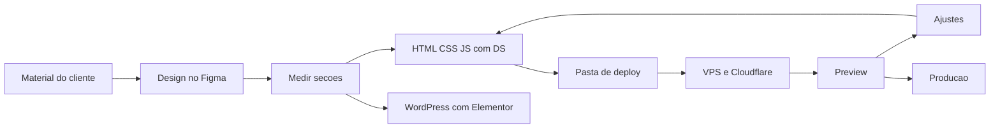

### Funcionalidades em detalhe

#### Design a partir do Figma

O playbook de replicação existe para o site sair idêntico ao design. A regra é medir, não interpretar.

- A ordem de verdade para valores visuais é: imagens exportadas do design final, código exportado do Figma, API REST do Figma e, por último, o guia.
- Antes de codar, mapeia-se as páginas do arquivo. Wireframe não é canônico, protótipo e versão final são.
- Cada seção é medida (tamanhos, espaços, cores, pesos de fonte) e só então codada.
- Depois de cada seção há um checkpoint: capturar a tela em 1920 px e comparar lado a lado com o design, corrigindo qualquer divergência acima de 4 px.
- A cada duas ou três seções o resultado é mostrado ao cliente.
- Quando o design não tem versão mobile, ela é derivada do desktop: coluna única até 880 px, escala tipográfica móvel e blocos decorativos grandes reduzidos ou ocultos.

#### Static Sites DS, o design system

É um sistema de tokens para sites estáticos, sem framework, sem bundler e sem build. Se um valor não é token, não se usa. Só duas coisas mudam por projeto: a matiz principal e a família tipográfica.

- Cor: paleta de uma única matiz em HSL, com rampa de 50 a 950. Sem branco e preto absolutos nem cinza neutro puro.
- Tipografia: 6 títulos (peso 600, altura de linha 120%) e 4 parágrafos (peso 300, 150%). A escala móvel entra a partir de 880 px.
- Espaçamento: múltiplos de 4 até 32 e múltiplos de 8 acima.
- Raios: 1, 4, 8, 24 e 99 px, e cada projeto escolhe um só.
- Sombra: por padrão nenhuma. Quando usada, é a pilha completa de 5 camadas.
- Grid: espaço de trabalho fixo e centralizado, de 12 colunas no desktop, 6 em tablet e 4 no celular.
- Componentes: 3 tamanhos de botão e 4 variações, cards, campos de formulário e rodapé padrão. Ícones são SVG inline, de um só traço.

#### Como cada site usa o DS

O DS é copiado para dentro de cada projeto, e a ordem de carregamento é obrigatória: fontes, tokens, base, componentes e, por último, o CSS do projeto. Por isso o tokens de um projeto pode divergir do canônico.

- Caminhos relativos sempre, porque os sites são servidos em subpasta.
- Um único `app.js` com blocos independentes e defensivos (menu móvel, FAQ, carrosséis, consentimento, formulário para WhatsApp). Cada bloco sai cedo se o elemento não existe na página.
- Em reestruturação de site de cliente, valem as fontes e as seções do cliente. O DS só preenche o que falta, como foco visível e um único H1.
- Imagens em WebP ou AVIF no tamanho real, fontes próprias com troca rápida e scripts com `defer`.

#### Do Figma ao Elementor

Para os projetos em WordPress existe uma ferramenta própria: um plugin do Figma que converte a seleção em um modelo JSON do Elementor, com contêineres e widgets mapeados a partir dos nós do design. Uma interface em Next.js acompanha o plugin.

#### Migração de WordPress para estático

O projeto da Center Seals parte de um export completo do WordPress e do Elementor, com banco e uploads, e o reconstrói como site estático. As pastas de espelho do WordPress servem de referência visual 1:1, e a reconstrução estática é a que vai ao ar. A Helitours segue a mesma lógica, com 12 páginas em português e 12 em inglês pareadas, GTM e banner de consentimento LGPD.

#### Publicação e previews

Cada site tem um endereço de preview por nome de cliente, servido pela VPS com o Cloudflare na frente.

- Arquivos de CSS, JS, imagens e fontes têm cache de 30 dias, e o HTML tem cache curto de 5 minutos.
- Por isso todo link de CSS e JS leva `?v=N`, e o número sobe a cada alteração. Sem isso, o HTML novo aparece com o CSS velho.
- Antes de apontar para um número novo, confere-se o sincronismo com um parâmetro descartável.
- Para um site com deploy próprio, como o do repositório alcetus-site, o container é Nginx em Docker.

### Arquitetura e stack

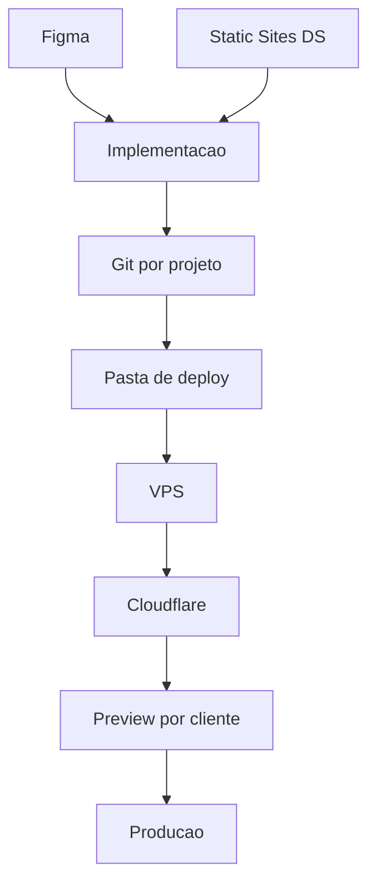

### Decisões de design e engenharia

- **Design system em tokens, sem framework.** Poucas variáveis por projeto tornam os sites consistentes e rápidos, e eliminam build e dependências.
- **Medir em vez de interpretar.** O playbook do Figma fixa a hierarquia de fontes de verdade, o que evita o "quase igual" e reduz retrabalho.
- **O DS vence o guia antigo.** O guia anterior foi mantido como histórico, e onde os dois divergem (pesos, escala, espaçamento, raios, sombra) vale o DS.
- **Cache longo com versão na URL.** Permite 30 dias de cache sem esperar o cliente limpar o navegador.
- **Respeitar o cliente em reestruturações.** Estrutura e fontes do cliente ficam, e o DS entra como camada de acabamento.

### Limites conhecidos

- O código dos projetos é privado, então a vitrine só mostra links e capturas.
- O DS é copiado para cada projeto, então as cópias podem divergir do canônico (o tokens do Helitours já difere).
- Uma pasta de deploy separada, sem git, recebe a cópia do tema, e é preciso saber em qual pasta se está mexendo.
- O workspace não tem build, lint nem testes automáticos. A verificação é feita no navegador.
- As etapas de briefing e de aprovação do cliente não têm um documento próprio nos arquivos. O que está registrado são o material de apoio nas pastas e os checkpoints de revisão.

### Galeria

#### Vetek Tintas Industriais

Distribuidor WEG em Piracicaba/SP: site institucional de tintas e soluções industriais. [Ver site](https://previa-sites.alcetus.com/Vetek/)

<table>
<tr>
<td width="74%" valign="top">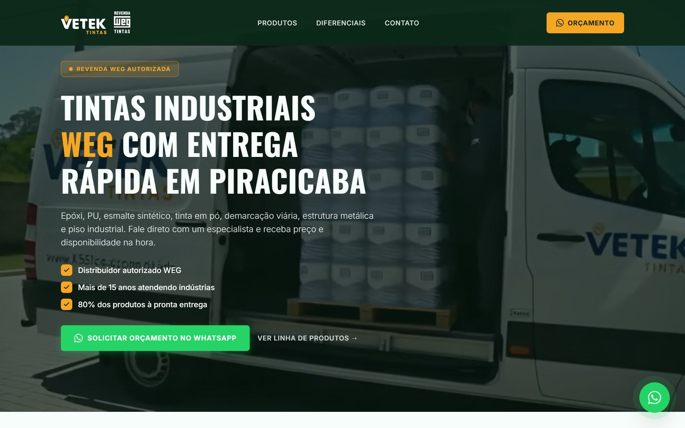</td>
<td width="26%" valign="top"></td>
</tr>
</table>

#### Catita Auto Center

Centro automotivo em Vargem Grande Paulista/SP: troca de óleo, pneus, baterias e mecânica. [Ver site](https://previa-sites.alcetus.com/CATITA/)

<table>
<tr>
<td width="74%" valign="top">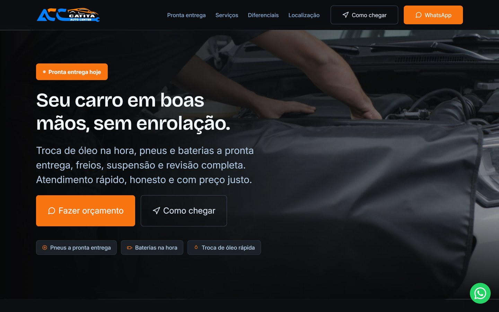</td>
<td width="26%" valign="top">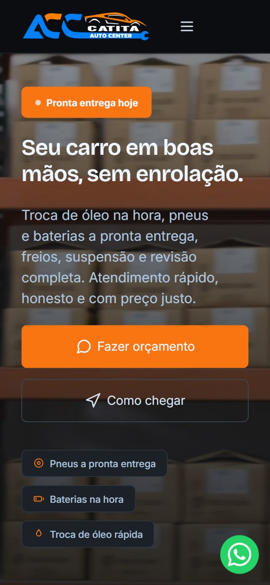</td>
</tr>
</table>

#### CEMC Soluções Industriais

Site institucional de soluções e equipamentos industriais. [Ver site](https://previa-sites.alcetus.com/CEMC/)

<table>
<tr>
<td width="74%" valign="top">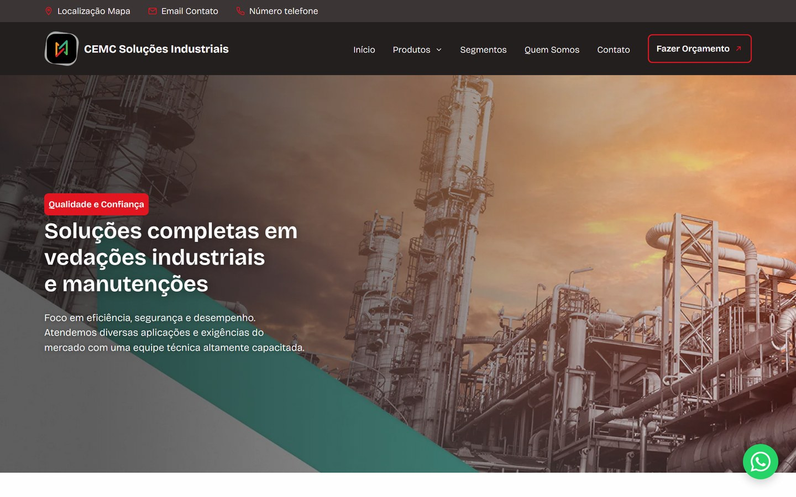</td>
<td width="26%" valign="top">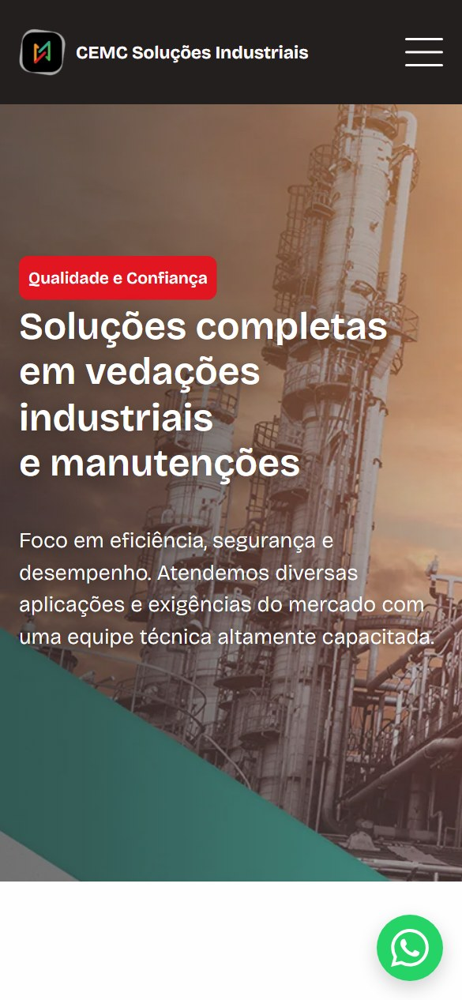</td>
</tr>
</table>

#### MPA Máquinas

Fabricante de equipamentos para reciclagem de plástico: catálogo e institucional. [Ver site](https://previa-sites.alcetus.com/MPAMaquinas/)

<table>
<tr>
<td width="74%" valign="top">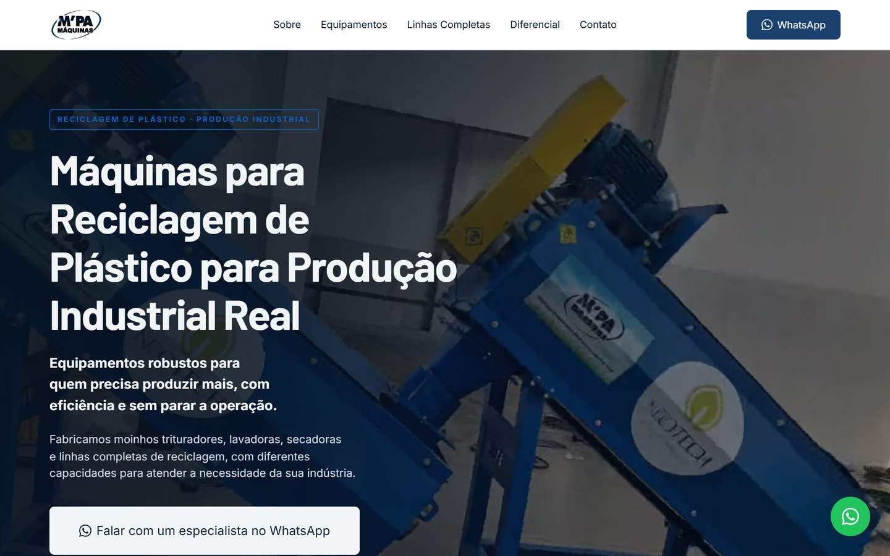</td>
<td width="26%" valign="top">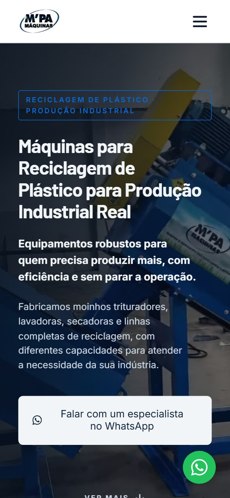</td>
</tr>
</table>

#### Rebecca Amorim Advocacia

Landing page de captação para advocacia especializada em recuperação de contas de Instagram. [Ver site](https://advrebeccaamorim.com.br)

<table>
<tr>
<td width="74%" valign="top"></td>
<td width="26%" valign="top"></td>
</tr>
</table>

## English

<table>
<tr>
<td align="center" width="33%"><b>20+</b> websites delivered</td><td align="center" width="33%"><b>5</b> industries served</td><td align="center" width="33%"><b>From Figma</b> to a live site</td>
</tr>
</table>

### Overview

This repository showcases more than 20 websites I designed and built for real clients, across industry, automotive, tourism, law and retail. The code of each project is private. What appears here are preview or production links and screenshots.

Clients cleared for naming include Vetek, Catita, CEMC, MPA Máquinas, Rebecca Amorim, Pétala Dourada, Helitours, Center Seals and MixPneus. The section below describes the way of working behind them: from client material to design, from design to code, and from code to preview and production.

### How it works

1. The client delivers the material: copy, photos, logo and references. In some projects there are support files in the folder, such as the photo list and the copy text.
2. Design is done in Figma. Final screens exported as images become the project's visual reference.
3. The site is built in one of two ways. New sites and restructurings ship as plain HTML, CSS and JavaScript on the Static Sites DS. Projects kept on WordPress continue with Elementor.
4. Each project is its own git repository, and every change is committed.
5. The theme is copied to the deploy folder, which is replicated to the VPS and available at a preview address per client.
6. The client reviews the preview, adjustments go back into the code, and the approved version goes to production.

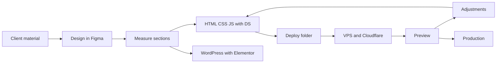

### Features in detail

#### Design from Figma

The replication playbook exists so the site comes out identical to the design. The rule is to measure, not interpret.

- The order of truth for visual values is: exported images of the final design, Figma code export, the Figma REST API and, last, the guide.
- Before coding, the file's pages are mapped. A wireframe is not canonical, while a prototype or final version is.
- Each section is measured (sizes, spacing, colors, font weights) and only then coded.
- After each section there is a checkpoint: capture the screen at 1920 px and compare side by side with the design, fixing any divergence above 4 px.
- Every two or three sections the result is shown to the client.
- When the design has no mobile version, it is derived from desktop: a single column up to 880 px, the mobile type scale, and large decorative blocks reduced or hidden.

#### Static Sites DS, the design system

It is a token system for static sites, with no framework, no bundler and no build. If a value is not a token, it is not used. Only two things change per project: the main hue and the typeface.

- Color: a single-hue HSL palette with a 50 to 950 ramp. No absolute white or black and no neutral pure grey.
- Typography: 6 headings (weight 600, line height 120%) and 4 paragraphs (weight 300, 150%). The mobile scale applies from 880 px.
- Spacing: multiples of 4 up to 32 and multiples of 8 above.
- Radii: 1, 4, 8, 24 and 99 px, and each project picks just one.
- Shadow: none by default. When used, it is the full 5-layer stack.
- Grid: a fixed, centered workspace with 12 columns on desktop, 6 on tablet and 4 on phones.
- Components: 3 button sizes and 4 variations, cards, form fields and a standard footer. Icons are inline SVG with a single stroke weight.

#### How each site uses the DS

The DS is copied into each project, and the load order is mandatory: fonts, tokens, base, components and, last, the project CSS. That is why a project's tokens file can diverge from the canonical one.

- Relative paths always, because sites are served from a subfolder.
- A single `app.js` with independent, defensive blocks (mobile menu, FAQ, carousels, consent, form to WhatsApp). Each block exits early if its element is not on the page.
- In a client restructuring, the client's fonts and sections win. The DS only fills in what is missing, such as visible focus and a single H1.
- Images in WebP or AVIF at real size, self-hosted fonts with fast swap, and scripts with `defer`.

#### From Figma to Elementor

For WordPress projects there is a purpose-built tool: a Figma plugin that converts the selection into an Elementor JSON template, with containers and widgets mapped from the design nodes. A Next.js interface comes with the plugin.

#### WordPress to static migration

The Center Seals project starts from a full WordPress and Elementor export, with database and uploads, and rebuilds it as a static site. The WordPress mirror folders serve as a 1:1 visual reference, and the static rebuild is the one that goes live. Helitours follows the same logic, with 12 pages in Portuguese and 12 in English paired, GTM and a LGPD consent banner.

#### Publishing and previews

Each site has a preview address by client name, served by the VPS with Cloudflare in front.

- CSS, JS, image and font files are cached for 30 days, and HTML has a short 5-minute cache.
- That is why every CSS and JS link carries `?v=N`, and the number goes up with every change. Without it, new HTML shows up with old CSS.
- Before pointing to a new number, sync is checked with a throwaway query parameter.
- For a site with its own deploy, such as the alcetus-site repository, the container is Nginx on Docker.

### Architecture and stack

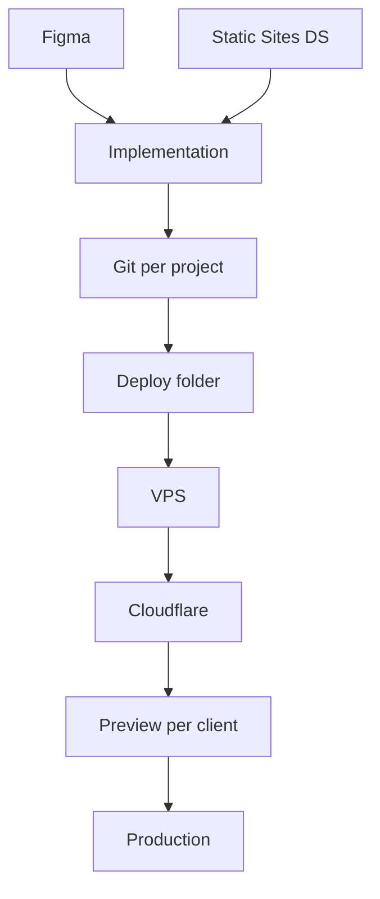

### Design and engineering decisions

- **A token-based design system, no framework.** Few variables per project keep sites consistent and fast, and remove build steps and dependencies.
- **Measure instead of interpret.** The Figma playbook fixes the hierarchy of sources of truth, which avoids "almost the same" and cuts rework.
- **The DS beats the old guide.** The earlier guide was kept as history, and where the two diverge (weights, scale, spacing, radii, shadow) the DS rules.
- **Long cache with a version in the URL.** It allows 30 days of caching without waiting for the client to clear the browser.
- **Respect the client in restructurings.** The client's structure and fonts stay, and the DS comes in as a finishing layer.

### Known limits

- Project code is private, so the showcase only shows links and screenshots.
- The DS is copied into each project, so copies can diverge from the canonical one (Helitours' tokens already differ).
- A separate deploy folder without git receives the theme copy, and you need to know which folder you are editing.
- The workspace has no build, lint or automated tests. Verification happens in the browser.
- The briefing and client approval steps have no document of their own in the files. What is recorded is the support material in the folders and the review checkpoints.

### Gallery

#### Vetek Tintas Industriais

WEG distributor in Piracicaba, Brazil: corporate website for industrial paints and solutions. [Visit the site](https://previa-sites.alcetus.com/Vetek/)

<table>
<tr>
<td width="74%" valign="top"></td>
<td width="26%" valign="top"></td>
</tr>
</table>

#### Catita Auto Center

Auto service center in Vargem Grande Paulista, Brazil: oil change, tires, batteries and mechanics. [Visit the site](https://previa-sites.alcetus.com/CATITA/)

<table>
<tr>
<td width="74%" valign="top"></td>
<td width="26%" valign="top"></td>
</tr>
</table>

#### CEMC Soluções Industriais

Corporate website for industrial solutions and equipment. [Visit the site](https://previa-sites.alcetus.com/CEMC/)

<table>
<tr>
<td width="74%" valign="top"></td>
<td width="26%" valign="top"></td>
</tr>
</table>

#### MPA Máquinas

Plastic-recycling equipment manufacturer: catalog and corporate site. [Visit the site](https://previa-sites.alcetus.com/MPAMaquinas/)

<table>
<tr>
<td width="74%" valign="top"></td>
<td width="26%" valign="top"></td>
</tr>
</table>

#### Rebecca Amorim Advocacia

Lead-capture landing page for a law practice specialized in Instagram account recovery. [Visit the site](https://advrebeccaamorim.com.br)

<table>
<tr>
<td width="74%" valign="top"></td>
<td width="26%" valign="top"></td>
</tr>
</table>

Contato · Contact: <a href="https://joaocouto.alcetus.com">joaocouto.alcetus.com</a> · <a href="mailto:joaopecouto77@gmail.com">joaopecouto77@gmail.com</a>
